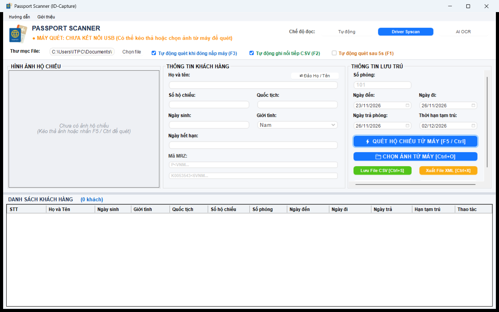
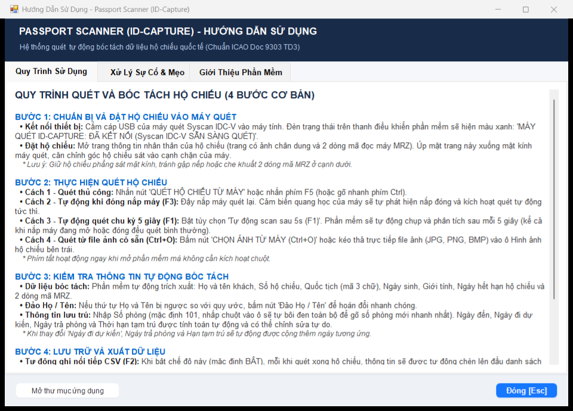
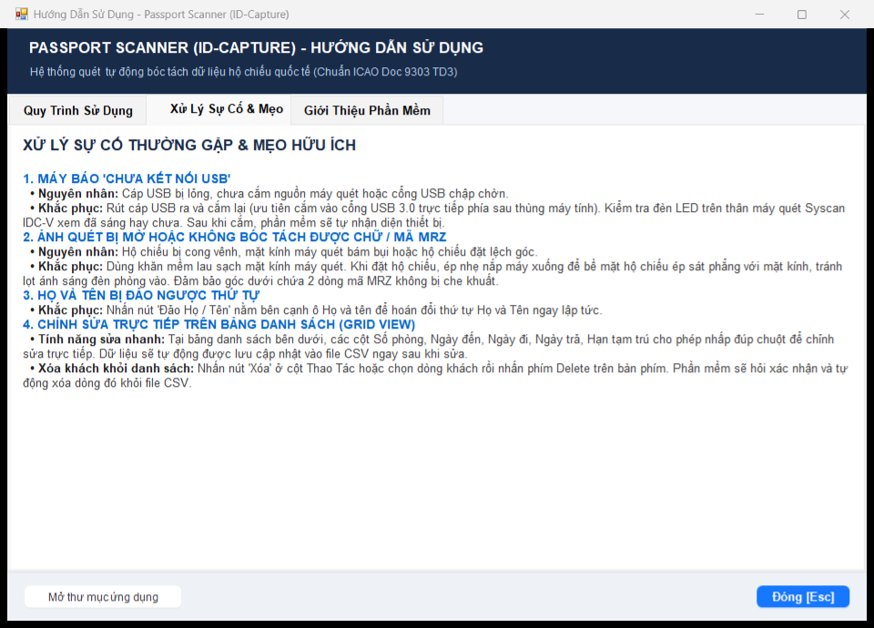
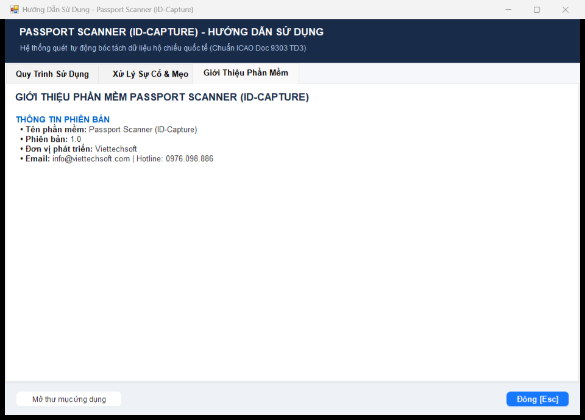

# Passport Scanner (ID-Capture) — Viettechsoft

Phần mềm quét, bóc tách tự động thông tin hộ chiếu quốc tế (chuẩn **ICAO Doc 9303 TD3**) và quản lý thông tin lưu trú khách hàng dành cho khách sạn, cơ sở lưu trú. Hỗ trợ máy quét chuyên dụng **Syscan IDC-V (ID-Capture)** kết hợp công nghệ nhận diện **AI Windows OCR**.

---

## 1. Giao diện phần mềm

### Màn hình chính


### Hướng dẫn sử dụng & Xử lý sự cố tích hợp
| Quy trình sử dụng | Xử lý sự cố & Mẹo | Giới thiệu |
| :---: | :---: | :---: |
|  |  |  |

---

## 2. Tính năng nổi bật

- **3 Chế độ đọc linh hoạt** (chọn nhanh ngay trên thanh tiêu đề):
  1. **Tự động**: Kết hợp thư viện gốc Syscan và AI Windows OCR để đạt độ chính xác cao nhất trên cả hộ chiếu mẫu cũ và hộ chiếu gắn chip mẫu mới.
  2. **Driver Syscan**: Sử dụng trực tiếp SDK gốc `ScanDll.dll` (`IO_GetIDResult`), tương thích mọi máy tính kể cả khi chưa cài gói ngôn ngữ Windows OCR.
  3. **AI OCR**: Chụp ảnh trực tiếp từ máy quét và nhận diện bằng **Windows Media OCR + FaceDetector** tích hợp sẵn trên Windows 10/11.
- **4 Cách kích hoạt quét tiện lợi**:
  - Quét thủ công: Bấm nút **QUÉT HỘ CHIẾU TỪ MÁY** hoặc nhấn phím **`F5` / `Ctrl`**.
  - Tự động quét khi đóng nắp máy (**`F3`**).
  - Tự động quét định kỳ sau mỗi 5 giây (**`F1`**).
  - Đọc từ file ảnh có sẵn: Bấm **CHỌN ẢNH TỪ MÁY (`Ctrl+O`)** hoặc kéo thả trực tiếp ảnh (`.jpg`, `.png`, `.bmp`, `.webp`...) vào khung hình ảnh.
- **Bóc tách đầy đủ trường thông tin**: Họ tên (có nút **Đảo Họ / Tên** nhanh), Số hộ chiếu, Quốc tịch (mã 3 chữ), Ngày sinh, Giới tính, Ngày hết hạn, 2 dòng mã MRZ và ảnh chân dung cắt tự động.
- **Quản lý lưu trú & xuất dữ liệu**:
  - Nhập Số phòng, Ngày đến, Ngày đi dự kiến, Ngày trả phòng, Thời hạn tạm trú (tự động tính toán và cho phép sửa trực tiếp trên bảng danh sách).
  - Tự động ghi nối tiếp file **CSV** (**`F2`** / **`Ctrl+S`**) và xuất file **XML** (**`Ctrl+X`**) phục vụ khai báo tạm trú.
- **Cơ chế tự phục hồi & chống xung đột DLL**: Tự động đồng bộ dữ liệu hiệu chuẩn cảm biến sang `C:\ProgramData\ID_Capture` (ngăn lỗi `-2017`) và cô lập thư viện `ScanDll.dll` / `IDC_Image_Process.dll`.

---

## 3. Yêu cầu hệ thống

- **Hệ điều hành**: Windows 10 / Windows 11 (32-bit hoặc 64-bit).
- **Framework**: .NET Framework 4.x (có sẵn trên Windows 10/11).
- **Phần cứng (tùy chọn)**: Máy quét hộ chiếu **Syscan IDC-V (ID-Capture)** kết nối cổng USB. (Vẫn sử dụng được tính năng đọc ảnh từ máy mà không cần cắm thiết bị).

---

## 4. Hướng dẫn cài đặt

### Cách 1: Cài đặt bằng bộ cài đóng gói sẵn (Khuyên dùng)
👉 **Tải bộ cài đặt mới nhất tại GitHub Releases**: [Tải Setup_PassportScanner_ID_Capture.exe (v1.0.0)](https://github.com/fbaduongth/PassportScanner_ID_Capture/releases/latest/download/Setup_PassportScanner_ID_Capture.exe) | [Trang Releases](https://github.com/fbaduongth/PassportScanner_ID_Capture/releases)

1. Tải và chạy tệp `Setup_PassportScanner_ID_Capture.exe` với quyền Administrator.
2. Chọn thư mục cài đặt (mặc định `C:\Program Files (x86)\Viettechsoft\ID_Capture`).
3. Giữ nguyên các tùy chọn mặc định:
   - Tự động cài đặt chứng chỉ & Driver **Syscan IDC-V USB Driver**.
   - Tự động đồng bộ dữ liệu cảm biến vào `C:\ProgramData\ID_Capture`.
   - Tự động kiểm tra và cài đặt gói **Windows AI OCR (`Language.OCR~~~en-US~0.0.1.0`)**.
   - Tạo duy nhất 1 biểu tượng ngoài Desktop và Start Menu.
4. Nhấn **Cài đặt ngay** và chờ hoàn tất.

> **Lưu ý trên Windows 11**: Nếu Device Manager báo lỗi chấm than vàng ở Driver Syscan IDC-V, hãy vào **Windows Security > Device Security > Core Isolation**, tắt **Memory Integrity** và khởi động lại máy.

### Cách 2: Biên dịch từ mã nguồn
```bat
:: Biên dịch ứng dụng chính (x86)
build.bat

:: Đóng gói bộ cài đặt hoàn chỉnh Setup_PassportScanner_ID_Capture.exe
powershell -ExecutionPolicy Bypass -File .\package_all.ps1
```

---

## 5. Hướng dẫn sử dụng nhanh

1. **Đặt hộ chiếu**: Mở trang nhân thân hộ chiếu (trang có ảnh chân dung và 2 dòng mã MRZ), úp xuống mặt kính máy quét và căn sát góc chặn.
2. **Quét hộ chiếu**: Nhấn **`F5`** (hoặc đóng nắp máy nếu bật `F3`), thông tin sẽ tự động điền vào khung **Thông tin khách hàng**.
3. **Điền thông tin lưu trú**: Nhập **Số phòng**, kiểm tra **Ngày đến / Ngày đi / Ngày trả / Hạn tạm trú**.
4. **Lưu trữ**: Khi bật **`F2` (Tự động ghi nối tiếp CSV)**, mỗi lần quét xong dữ liệu sẽ tự động lưu vào file CSV trong thư mục đã chọn. Có thể bấm **`Ctrl+X`** để xuất file XML.

### Phím tắt nhanh
| Phím tắt | Chức năng |
| :--- | :--- |
| `F5` / `Ctrl` | Quét hộ chiếu từ máy |
| `Ctrl + O` | Chọn ảnh hộ chiếu từ máy tính |
| `Ctrl + S` | Ghi thông tin khách hiện tại vào file CSV |
| `Ctrl + X` | Xuất file XML |
| `F1` | Bật/Tắt tự động quét chu kỳ 5 giây |
| `F2` | Bật/Tắt tự động ghi nối tiếp CSV |
| `F3` | Bật/Tắt tự động quét khi đóng nắp máy |
| `Delete` | Xóa dòng khách đang chọn khỏi bảng và CSV |

---

## 6. Xử lý sự cố thường gặp

- **Máy báo `CHƯA KẾT NỐI USB`**: Rút cáp USB cắm lại (ưu tiên cổng USB trực tiếp phía sau thùng máy), hoặc chạy lại `driver\install_driver.bat` với quyền Administrator.
- **Thiếu gói AI Windows OCR**: Mở PowerShell với quyền Administrator và chạy:
  ```powershell
  DISM /Online /Add-Capability /CapabilityName:Language.OCR~~~en-US~0.0.1.0
  ```
  Hoặc chuyển sang chế độ **Driver Syscan** trên thanh tiêu đề để quét trực tiếp.
- **Họ và Tên bị ngược thứ tự**: Nhấn nút **Đảo Họ / Tên** bên cạnh ô Họ và tên.

---

**Phát triển bởi**: Viettechsoft  
**Email**: info@viettechsoft.com | **Hotline**: 0976.098.886
